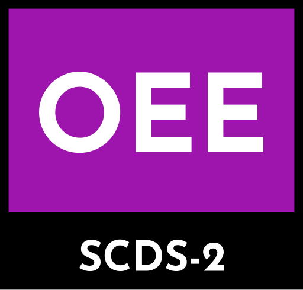

# Seam
Seam is a reactive state and animation library, useful in many contexts including UI and game mechanics.

Read everything you need to know about Seam on the documentation site: https://seam.igottic.com/

## Installation
You can install Seam from pesde:

```sh
pesde add miagobble/seam
```

Or from Wally. See info about that [on the Wally website](https://wally.run/package/miagobble/seam).

## Performance Considerations
Seam is a lightweight library, made possible by the flattened dependency graph.

Rather than states being managed by a central location, states self-sustain and only connect to other states as needed. Internally, this is done through every state's changed signal, which any other state can connect to. Additionally, animation states have the ability to sleep as needed when not in active motion. For example, when making UI, you are not re-evaluating each button on screen all of the time, instead only as needed.

When you are updating many states at the same time, it's recommended you use `Batch` to bulk-update states. This prevents a lot of stress that would've been put on the dependency graph.

There is a moderate impact on memory, since every state and most other things in Seam run on metatables. This is done to simplify the codebase and allow a flattened structure. Because metatables are used as both tables and functions to separate backend and frontend behavior, you should be able to remove most parts of Seam without breaking it should you choose to make a fork. For example, if you don't need most utilities, states, and declarations, you can remove what you need to improve on memory overhead.

## Contribute to Seam!
Contributions are welcome and usually put into production. I'm always looking for useful features, bug fixes, typechecking improvements, and backend improvements. Should you choose to contribute, make sure you create a pull request into the `dev` branch, not `main`.

You're also free to create issues to point out problems, and myself or another contributor can patch it up.

## SCDS Rating
